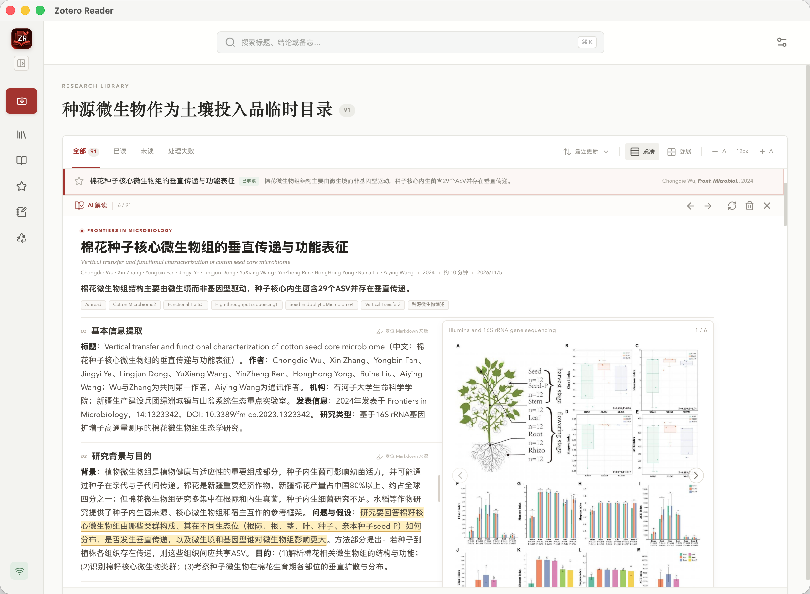

# Zotero Reader

面向科研工作者的本地优先桌面阅读器：从 Zotero 分类导入文献，使用 Doc2X 解析 PDF，使用 DeepSeek 生成中文七段解读，并围绕单篇论文进行流式问答。

## 下载与安装

下载安装包即可使用。前往 **[GitHub Releases 下载最新版](https://github.com/gaospecial/zotero-reader/releases/latest)**，选择适合电脑的安装包：

| 操作系统 | 安装包 | 安装方法 |
| --- | --- | --- |
| macOS（Apple Silicon） | 文件名以 `_aarch64.dmg` 结尾 | 打开 DMG，将 Zotero Reader 拖入“应用程序”文件夹 |
| 64 位 Windows | 文件名以 `_x64-setup.exe` 结尾 | 运行安装程序并按照提示完成安装 |

安装包名称中的版本号会随版本更新，请以最新 Release 页面为准。目前 macOS 安装包适用于 Apple Silicon 芯片，不包括 Intel Mac。

> macOS 安装包尚未经过 Apple 公证。如果系统阻止打开，可在“系统设置 → 隐私与安全性”中查看安全提示；请仅在确认安装包来自上述项目 Release 页面后选择继续打开。

## 功能亮点

### Zotero 文库管理

- **分类导入与同步**：递归选择 Zotero 分类，导入前预览文献数量并检查 PDF 可读性；已加入分类可随时同步新文献、题录变化和 PDF 附件。
- **清晰的文献列表**：按全部、已读、未读和处理失败筛选文献，支持星标、全文检索、紧凑或舒适布局以及字号调整。
- **只读连接 Zotero**：不读取或修改 `zotero.sqlite`，不复制 PDF；没有 PDF 的条目仍保留原始题录与摘要。

### AI 辅助阅读

- **PDF 结构化解析**：通过 Doc2X 生成可保存历史版本的 Markdown，整理论文图片并定位来源章节。
- **中文七段解读**：通过 DeepSeek 梳理论文基本信息、研究背景、方法、结果与结论，结合论文图片提供上下文。
- **围绕单篇论文问答**：支持流式问答和问答历史；处理失败时可重试，后台任务可取消。

### 笔记与知识整理

- **原文高亮与锚点笔记**：在阅读位置创建彩色高亮和选段备忘，并可从备忘中心回到原文对应位置。
- **个人备忘与问答留痕**：集中查看文献笔记、选段原文和问答记录，方便复习与后续写作。
- **本地数据管理**：提供应用回收站与恢复功能，并可将 SQLite、Markdown 历史版本和图片打包为 ZIP 备份。

## 使用界面

### 界面导览

- **左侧导航与分类树**：切换文库、备忘和回收站，按 Zotero 分类浏览文献，并查看分类中的文献处理状态。
- **顶部全局搜索**：按标题、结论或备忘内容查找文献。
- **文献列表与显示控制**：筛选阅读状态，切换列表布局、调整字号；选中文献后可在当前页面直接展开阅读。
- **展开式阅读区**：集中展示论文标题、作者与来源、结构化 AI 解读和论文图片，可继续进行高亮、备忘与问答。

## 快速上手

1. **启动 Zotero**：打开 Zotero 桌面端，确保本机 Zotero 服务可通过 `http://127.0.0.1:23119` 访问。
2. **配置 AI 服务**：准备 Doc2X 与 DeepSeek API Key，在 Zotero Reader 的“设置 → 服务连接”中分别保存。
3. **导入文献**：在分类目录中选择需要阅读的 Zotero 分类，预览并加入文库；后续通过“与 Zotero 同步”更新内容。
4. **阅读与问答**：点击文献展开阅读区，查看题录、AI 解读和论文图片，或围绕当前论文提问。
5. **整理笔记**：对重要内容添加高亮和备忘，之后可通过全局搜索或备忘中心重新定位原文。
6. **备份数据**：定期导出 ZIP 备份；误删内容会先进入应用回收站，需要时可恢复。

## 设置说明

### 服务连接

API Key 保存在本机应用数据目录的 `config.json` 中，不写入文献数据库或备份。设置页默认隐藏 API Key，可点击眼睛图标查看或再次隐藏。也可以在设置页点击“打开 config.json”直接编辑配置。

常用配置包括：

- `deepseek.apiKey`：DeepSeek API Key。
- `doc2x.apiKey`：Doc2X API Key。
- `deepseek.model`：用于文献解读与问答的模型。
- `zotero.dataDir`：Zotero 数据目录，默认为 `~/Zotero`。
- `zotero.rootDir`：`attachments:` 链接附件的根目录，仅使用此类附件时需要设置。
- `literatureInterpretation.prompt`：文献解读提示词，可在设置页查看和修改。

修改 Zotero 本地 API 地址后需要重启应用。请勿将包含真实 API Key 的配置文件或备份发送给他人。

### PDF 文件路径

应用优先从 Zotero 附件的本地路径读取 PDF，支持绝对路径、`attachments:`、`storage:` 和纯文件名；本地路径不可用时，会尝试通过 Zotero 文件接口读取。

如果 Zotero 数据目录不在默认位置，请在设置中指定 `zotero.dataDir`；该目录可以指向 Zotero 根目录，也可以直接指向其中的 `storage` 目录。使用 `attachments:` 链接附件时，还需要设置 `zotero.rootDir`。

无法读取的 PDF 会显示警告并被单独跳过，不影响同一分类中的其他文献。修复文件路径后重新同步即可恢复处理；没有 PDF 的条目只展示题录与摘要，不调用 AI 解读或问答。

## 数据与备份

应用数据保存在本机，包括：

- `reader.db`：文献元数据、分类关系、解读索引、备忘、问答、状态和设置。
- `config.json`：API Key、模型、接口地址、Zotero 路径和提示词等配置。
- `files/`：按文献及版本保存的 Markdown 与图片。

PDF 仍保留在 Zotero 附件的原位置，不进入应用备份。恢复备份会替换当前本地数据库与解析文件，操作前建议先导出一份新备份。

项目更新日志见 [CHANGELOG.md](CHANGELOG.md)。
